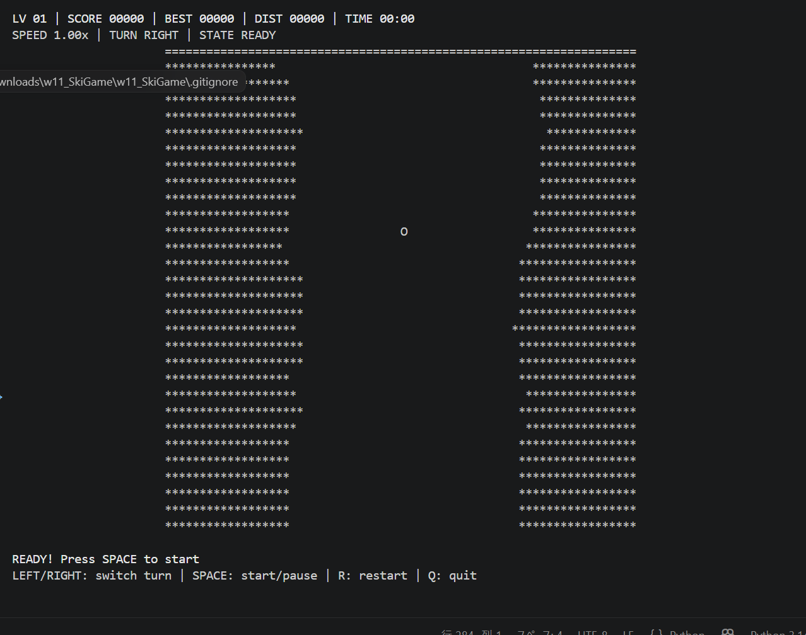

# ASCIIスキーゲーム（改良版）

## ゲームの概要

ターミナル画面上で木（`A`）や崖（`*`）を避けながら滑走し、距離やスコアを伸ばしていくASCIIスキーゲームです。コースが進むにつれてレベルや速度が上がり、より高いスコアやベストスコアを目指します。

## 動作環境

- OS：Windows（実際に動作確認したOSに書き換えてください）
- Python：Python 3.10 以上（実際に確認したバージョンに書き換えてください）
- 必要なライブラリ：`curses`（Windows環境で未導入の場合は `windows-curses` が必要）

## インストール方法

Windowsで `curses` が利用できない場合は、対話型ターミナルで以下を実行して `windows-curses` をインストールします。

```bash
py -m pip install windows-curses

## 起動方法
py w11_ski_demo.py

（実際にゲームを起動できるコマンドや手順を記載する）

<!-- コマンドの記述例：
```bash
python main.py
```
ファイル名やコマンドは自分のゲームに合わせて変更してください。
-->

## 操作方法

-Space：ゲーム開始／一時停止／再開

← / →：左右への旋回方向の切り替え

R：ゲームオーバー後の再起動

Q：ゲームの終了

## 追加・改良した機能

### 改良機能01：（機能名）
コースが1行進むごとのスコア加算を固定の1点ではなく現在のレベル（state["level"]）に応じた値に変更し、レベルが上がるほどスコアが伸びるようにしました。

### 改良機能02：（機能名）

ゲームオーバー時に最高スコア（best_score）を更新して保持し、再起動（R）後も画面上部のHUDに BEST として表示されるようにしました。

### 改良機能03：（機能名）

（改良内容を説明する）

ゲームオーバー時のメッセージに、衝突理由（CLIFF! / TREE!）だけでなく、その回のスコア（SCORE）と滑走距離（DIST）を表示するようにしました。

## スクリーンショット

（ゲームの実行画面を掲載する）

<!-- 画像の記述例：



## 既知の問題・制限事項

ターミナルのウィンドウサイズ（幅・高さ）が小さすぎると表示が制限されるため、十分な広さのターミナルで実行してください。


## クレジット

- ベースとなったゲーム：（配布ゲームの名称。オリジナル作品の場合はその旨を記載）
- 使用した外部素材・ライブラリ：（名称、出典、必要なライセンス表記など。該当する場合）

<!-- 提出前の確認（このコメントは削除しても構いません）
- 括弧内の説明や記入例を自分の作品の情報に書き換えたか
- READMEの手順でゲームを起動できるか
- 実装済みの機能と未実装の機能を区別しているか
- 個人情報、パスワード、APIキーなどを含んでいないか
- 公開するコードや素材の利用条件を確認したか
- GitHub上でREADMEと画像が正しく表示されているか
-->
